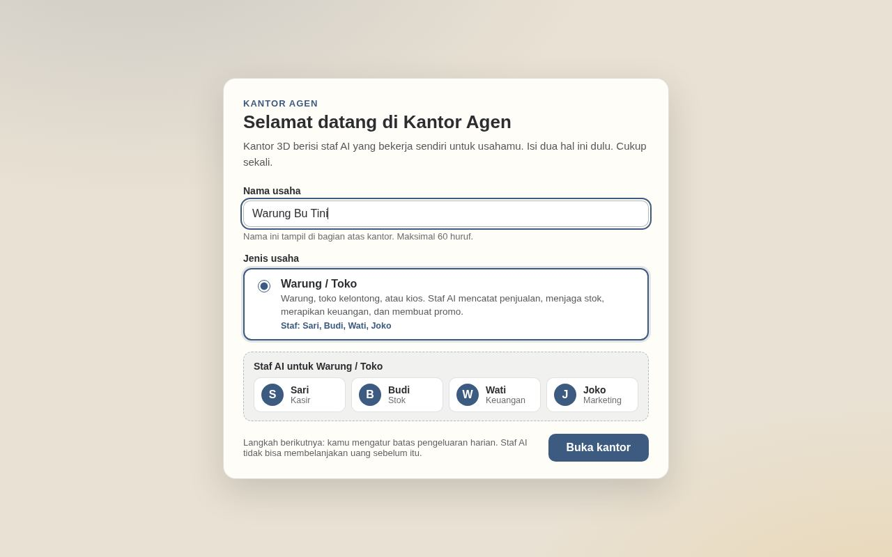
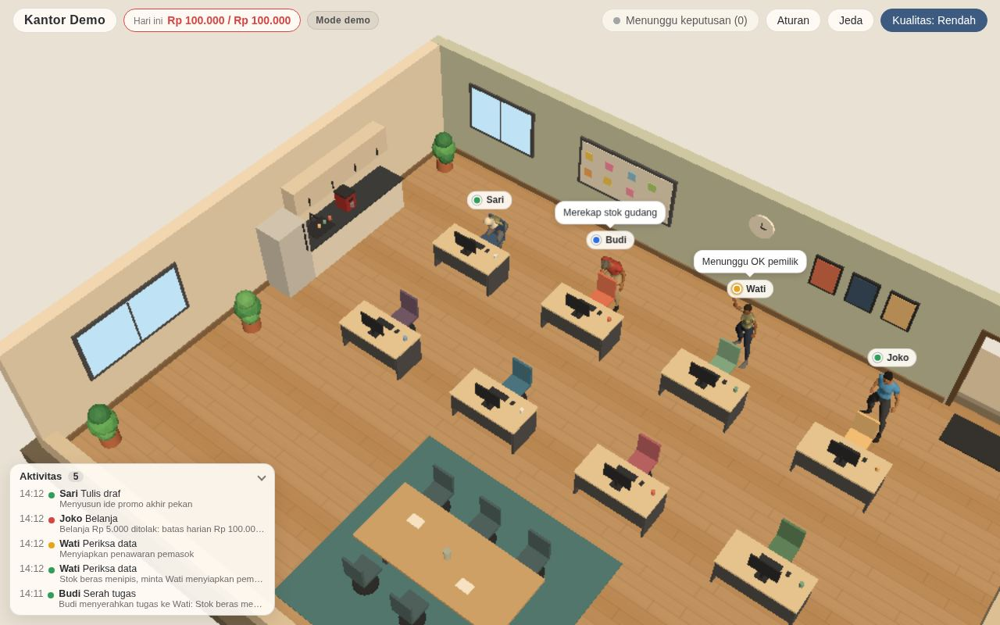
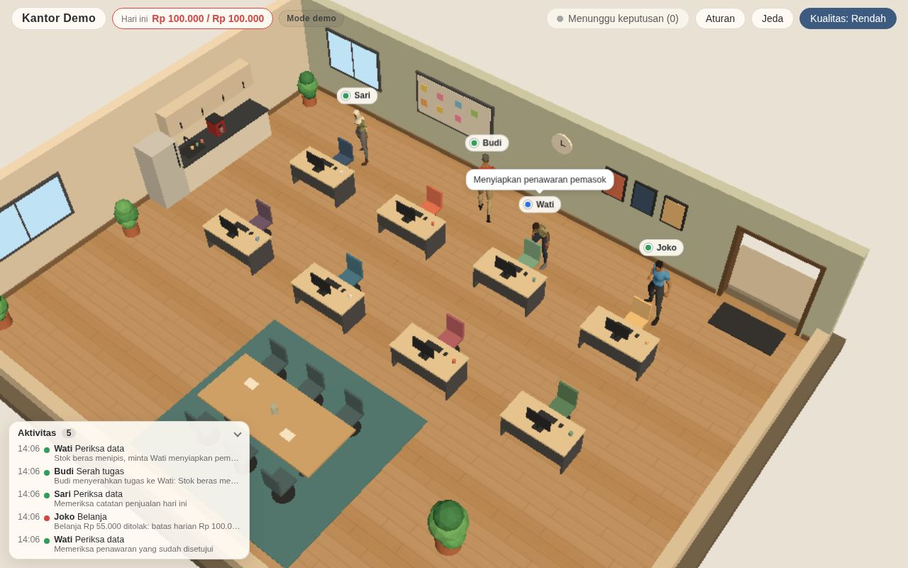
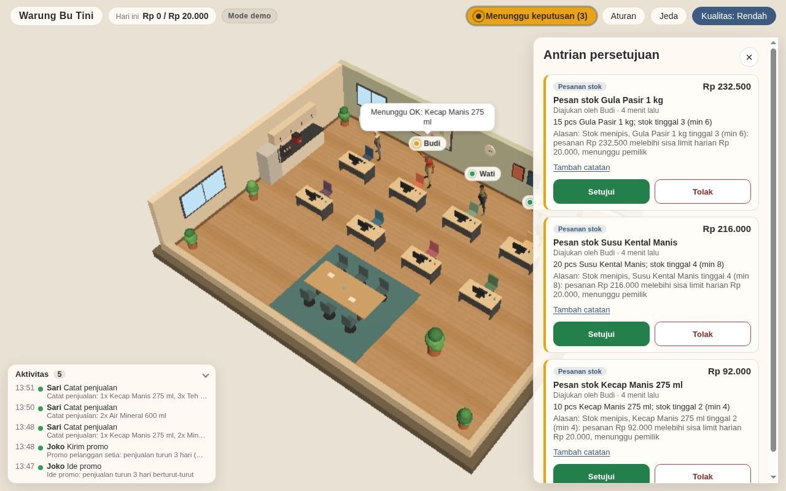
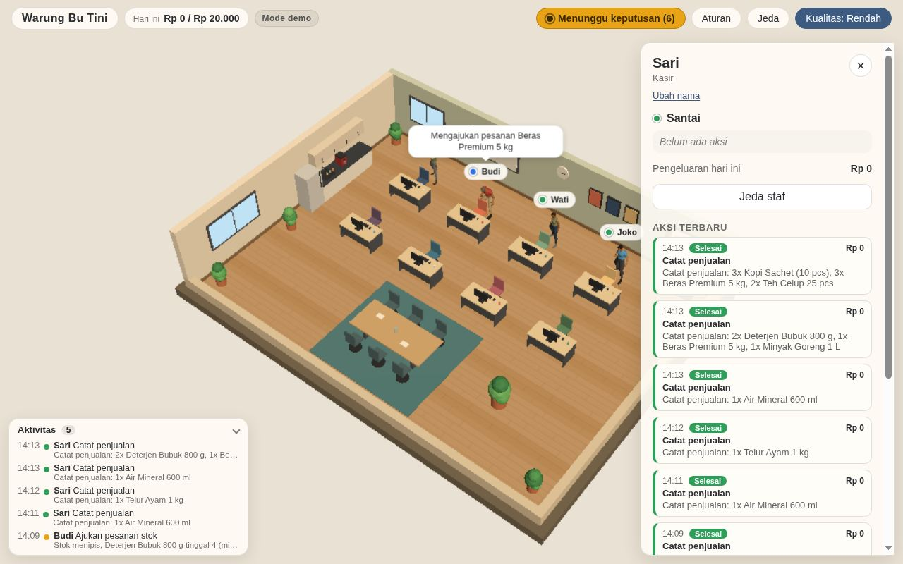

# Kantor Agen

[](LICENSE)
[](pyproject.toml)

**A 3D office where autonomous AI staff run a small Indonesian business (UMKM) inside limits the owner sets once.**
Kiroween 2026, Skeleton Crew category.

**Ringkasan (Bahasa Indonesia).** Kantor Agen adalah kantor 3D berisi staf AI yang bekerja sendiri untuk warung atau usaha jasa kecil. Pemilik mengatur batas belanja harian dan aksi yang diblokir satu kali. Batas itu dijaga oleh kode di backend, bukan oleh prompt: setiap pengeluaran diperiksa, pesan ke pelanggan hanya masuk kotak keluar (outbox, tidak pernah terkirim), dan apa pun di luar batas menunggu persetujuan pemilik. Satu kerangka (`skeleton/`) menjalankan dua aplikasi: Kantor Warung dan Kantor Jasa. Demo berjalan di komputer sendiri tanpa API key dan tanpa internet. Tampilan aplikasi berbahasa Indonesia.



## Why it matters

Small business owners cannot watch an AI agent all day, and they cannot afford one that overspends or messages a customer by mistake. Kantor Agen makes the staff act on their own while the owner stays in control:

- **Limits live in backend code.** A policy engine ([`skeleton/policy/engine.py`](skeleton/policy/engine.py)) checks every spend against the daily limit and the blocked actions. The model never approves anything.
- **Customer messages are never sent.** They go to an outbox, and the table only accepts `pending` rows.
- **Everything is logged.** The activity log is append-only (SQLite triggers refuse updates and deletes).
- **The owner decides the rest.** A purchase or invoice above the limit waits in an approval queue (Setujui or Tolak). The owner can pause the whole office or one agent.
- **The scene tells the truth.** A character sits and types only while the backend reports a running task. It walks to a colleague for a handoff, and raises a hand while it waits for the owner.




The two screenshots above come from the skeleton demo (four dummy agents, "Kantor Demo"). The two below come from Kantor Warung, with the daily limit set to Rp 20.000 to force an over-limit order.




## Two applications, one skeleton

| Part | What it holds | Lines (Python / JS / HTML / CSS) |
|---|---|---|
| `skeleton/` | config, SQLite, clock, event bus; policy engine and approvals; heartbeat, Manager, pacing, model client; activity log; API, SSE, onboarding and the 3D front end | 4,633 Python (27 files); 7,651 JS, 148 HTML, 889 CSS (23 files) |
| `apps/kantor_warung/` | shop roles (cashier, stock, finance, marketing), data, seed, template | 1,826 Python (7 files) |
| `apps/kantor_jasa/` | service-business roles (booking, billing, follow-up), data, schema, seed, template | 2,668 Python (8 files) |
| `apps/kantor-*/app.py` | run entry points | 19 each |

Counted with `wc -l` on tracked files at commit `a9e8490`. The skeleton count leaves out the vendored three.js, the 3D assets and the one dev viewer page. The skeleton never imports from `apps/`.

```
skeleton/            shared core (core, policy, runtime, log, office + static front end)
apps/kantor-warung/  run entry point and README for the shop app
apps/kantor-jasa/    run entry point and README for the service app
apps/kantor_warung/  importable code of the shop app
apps/kantor_jasa/    importable code of the service app
tests/               pytest suite, tests/properties/ (Hypothesis), tests/js/ (Node)
docs/                KIRO_USAGE.md, pacing.md, performance.md, images/
.kiro/               specs, steering, hook
```

The folders with hyphens are the two application folders, each with its run command. Python cannot import a hyphenated name, so the importable code sits next to them in `apps/kantor_warung` and `apps/kantor_jasa`.

## Quick start

Needs Python 3.11 or newer (`pyproject.toml`). I verified a clean install and run on Python 3.14.8, Linux; other versions are not tested. No API key, no internet access after install, and no GPU server are needed.

```
git clone https://github.com/Maftuuh1922/kantor-agen.git
cd kantor-agen
git checkout kantor-agen/build    # the work is on this branch until it is merged to main
python3 -m venv .venv && .venv/bin/pip install -e ".[dev]"
```

Run either app from the repository root:

```
.venv/bin/python apps/kantor-warung/app.py --port 8000
.venv/bin/python apps/kantor-jasa/app.py --port 8001
```

Open <http://127.0.0.1:8000/> (Warung) or <http://127.0.0.1:8001/> (Jasa). Check the backend with `curl http://127.0.0.1:8000/api/office`.

**First run.** Type a business name and press **Buka kantor** (the business type is preselected). The AI staff are hired and demo data is loaded. The **Atur aturan belanja** dialog then asks for the daily spending limit and the actions to block. Press **Simpan dan mulai**, and the staff start working. Nothing can be spent before that.

The staff wake up every 300 seconds by default. For a lively first look add `--interval 10`. Later runs open straight into the office.

Options (full tables in [`apps/kantor-warung/README.md`](apps/kantor-warung/README.md) and [`apps/kantor-jasa/README.md`](apps/kantor-jasa/README.md)):

| Option | Meaning |
|---|---|
| `--interval N` | seconds between heartbeat ticks (at least 1) |
| `--no-pacing`, `--pace-min N`, `--pace-max N` | turn off or tune the visible "think time" ([docs/pacing.md](docs/pacing.md)) |
| `--real-hours` | keep real business hours, so staff idle at night. By default the simulated customers come at any hour |
| `--db FILE` | SQLite file. Default `kantor-warung.db` or `kantor-jasa.db` in the folder you start from; one file per app |

**Skeleton demo** (four dummy agents, in-memory database, a scripted loop of work, handoff, waiting and a rejected spend):

```
.venv/bin/python -m skeleton.office.demo --port 8000
```

It also takes `--db` (`:memory:` by default) and `--interval` (default 6). **Offline preview without a backend:** serve the static folder and open `/?mock=1`.

```
python3 -m http.server 8765 --directory skeleton/office/static --bind 127.0.0.1
```

Then open <http://127.0.0.1:8765/?mock=1>. Add `?quality=low` on a slow machine.

**Real model (optional).** Copy `.env.example` to `.env` in the folder where you start the app, then set `KANTOR_LLM_BASE_URL`, `KANTOR_LLM_API_KEY`, `KANTOR_MODEL_LOW` and `KANTOR_MODEL_STRONG` (any OpenAI-style `/chat/completions` endpoint). The key stays on the server and never reaches the browser. `.env` is in `.gitignore`; never commit keys. The demo path is tested; the real-model path was not run against a live provider for this README.

## Built with Kiro

The project follows the Kiro IDE spec workflow: [requirements, design and task plan](.kiro/specs/kantor-agen/) were committed before the first code. Three steering files in [`.kiro/steering/`](.kiro/steering/) (`product.md`, `tech.md`, `rules.md`) hold the hard rules, such as integer rupiah and policy checks only in backend code. One hook, [`run-tests-on-save.kiro.hook`](.kiro/hooks/run-tests-on-save.kiro.hook), runs pytest when a Python file is saved. The design lists seven correctness properties, and each has a Hypothesis test. [`docs/KIRO_USAGE.md`](docs/KIRO_USAGE.md) gives the evidence, what changed during the build, and which Kiro features were not used.

## Testing

```
.venv/bin/pytest -q
node --test tests/js/
```

On a clean clone at `a9e8490`: `pytest --collect-only` found 1,335 tests and all 1,335 passed (about 8 minutes on a busy machine; two of them run the Node suite). `node --test tests/js/` ran 144 tests, all passing.

The seven properties are stock never negative, sale total exact, daily spend within the limit, blocked actions never run, customer messages never sent, paused means no new work, and visual state matches real state. Their tests are in [`tests/properties/`](tests/properties/), together with an eighth file for the approval queue (55 tests in that folder).

## Honest limits

- No payment and no real message sending. Messages stay in the outbox.
- The sales feed (Warung) and booking feed (Jasa) are simulators, not real data.
- Pacing is a visual delay: a task is held "running" for a few seconds so you can see work. Nothing is computed during the wait ([docs/pacing.md](docs/pacing.md)).
- The targets of 30 fps and a 5 second load are not verified on real hardware ([docs/performance.md](docs/performance.md)).
- The free character pack has two body shapes (Superhero male and female), so looks vary by tint, hair and clothes.
- One business per database, one user, no login. The app listens on 127.0.0.1 only, unless you pass `--host`, which exposes it without any login.

## License and credits

MIT, see [LICENSE](LICENSE). The 3D characters and animations (Quaternius) and the furniture (Kenney) are CC0. three.js is MIT. Details are in [CREDITS.md](CREDITS.md).
